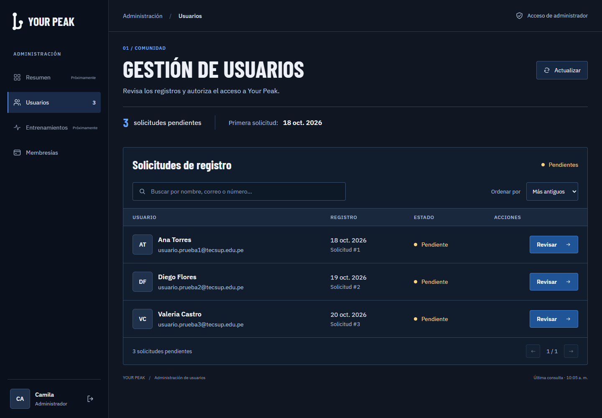

# YourPeak

## Contexto del proyecto

YourPeak es una plataforma de gestión y seguimiento de entrenamiento para un gimnasio. La idea general contempla cuentas de clientes, membresías, registro físico, disponibilidad, rutinas, ejercicios y sesiones de entrenamiento. El esquema SQL que está ahora en el repositorio cubre solo una parte de esa base; no representa todavía todas las áreas del diseño.

La aplicación web utiliza React como interfaz y Django como backend web, además de la aplicación móvil Android. Spring Boot ofrece los servicios de cuenta y conserva los datos de usuario en MySQL. La base de Django es SQLite y se usa para la sesión web; no es una copia de MySQL ni debe almacenar las cuentas de usuario.

## Arquitectura y estado actual

| Parte | Tecnología | Estado |
|---|---|---|
| Servicio de cuentas | Spring Boot, Java 21 y MySQL | Tiene registro y login por endpoints. Usa `yourpeak_db`; la conexión se configura en `Backend-spring/src/main/resources/application.properties`. |
| Web/backend | Django y SQLite | Expone la API web para React, llama a los endpoints de Spring Boot y conserva solo el ID del usuario en su sesión SQLite. Mantiene los formularios provisionales. |
| Web/interfaz final | React | Registro, login, estado de aprobación, perfil básico, cierre de sesión y panel administrativo de usuarios y planes de membresía. Acceso basado en Figma y panel administrativo azul marino con tipografía propia, adaptable a escritorio y móvil. |
| Aplicación móvil | Android, Kotlin y Jetpack Compose | Registro, login, perfil básico y cierre de sesión conectados directamente a Spring Boot con Retrofit. Diseño basado en el front web, en tonos azules. |
| Base de datos | MySQL/MariaDB | El esquema completo y sus catálogos iniciales están en `Backend-spring/database/yourpeak_schema.sql`. No contiene cuentas reales. |

### Recorrido actual de login

1. La persona completa el formulario de React. React envía la solicitud a Django mediante `/api/web/login/`, con la protección CSRF correspondiente.
2. Django reenvía correo y contraseña a Spring Boot mediante `POST /api/auth/login`; Django no comprueba contraseñas ni busca cuentas en SQLite.
3. Spring Boot valida la contraseña y consulta la cuenta en MySQL. El registro funciona igual: Django envía los datos a `POST /api/auth/registro` y Spring crea el usuario y su perfil de cliente en MySQL.
4. Si el login es correcto, Django guarda solo el ID de usuario en su sesión SQLite. Al cerrar sesión, Django borra esa sesión.
5. Para mostrar el perfil, Django pide `GET /api/auth/usuarios/{idUsuario}` a Spring usando el encabezado `X-Internal-Api-Key`.
6. React usa el rol y el estado devueltos por Spring para mostrar el panel administrativo, la pantalla de espera o la cuenta activa. Iniciar sesión no cambia el estado PENDIENTE.

Por tanto, MySQL es la fuente de verdad para las cuentas. SQLite guarda los datos de sesión propios de Django y no es una copia de MySQL. Django y Spring comparten una clave interna de desarrollo definida en sus archivos de configuración para que Django pueda consultar el perfil y comunicarse con los endpoints internos.

## Requisitos

- Java 21.
- MySQL o MariaDB en ejecución.
- Python 3.12, 3.13 o 3.14 (versiones compatibles con la versión de Django fijada en `Backend-django/requirements.txt`).
- Git.
- Node.js y npm para ejecutar el frontend React. Se verificó localmente con Node.js 24 y npm 11.

## 1. Preparar MySQL para Spring Boot

1. Inicia el servicio local de MySQL/MariaDB.
2. En SQLyog o MySQL Workbench abre y ejecuta `Backend-spring/database/yourpeak_schema.sql`. El archivo crea `yourpeak_db`, las tablas y los catálogos iniciales.
3. Ejecútalo sobre una base vacía. Si ya existe una base de prueba con tablas, expórtala primero si quieres conservar sus datos y luego vacíala o elimínala antes de cargar el esquema nuevo: el archivo no borra ni reemplaza tablas existentes.
4. El SQL no contiene cuentas reales. Crea una cuenta desde el formulario de registro cuando Spring Boot, Django y React estén en marcha.

Este archivo es el esquema y los catálogos iniciales del proyecto; no es una copia de los datos de MySQL de otro desarrollador. Spring tiene `ddl-auto=validate`: al arrancar comprueba que las tablas que usa existan, pero no crea ni modifica el esquema.

## 2. Configurar y arrancar Spring Boot

Abre una terminal en `Backend-spring`. La configuración predeterminada espera MySQL en `localhost:3306`, la base `yourpeak_db`, usuario `root` sin contraseña y Spring Boot en el puerto `8080`. Si tu MySQL tiene otros datos, define las variables antes de arrancar:

```powershell
$env:DB_URL = "jdbc:mysql://localhost:3306/yourpeak_db"
$env:DB_USERNAME = "root"
$env:DB_PASSWORD = "tu_clave_de_mysql"
```

Si MySQL usa un puerto distinto de `3306`, cambia el puerto en `DB_URL`, por ejemplo `jdbc:mysql://localhost:3307/yourpeak_db`. Si el puerto `8080` está ocupado, cambia el puerto de Spring. Por ejemplo:

```powershell
$env:SERVER_PORT = "8081"
```

Arranca Spring:

```powershell
.\mvnw.cmd spring-boot:run
```

La clave interna de desarrollo ya está configurada en el repositorio y coincide con el valor de `Backend-django/config/settings.py`. En este proyecto académico se usa un valor compartido para facilitar las pruebas locales; no debe reutilizarse fuera del entorno de desarrollo.

## 3. Configurar y arrancar Django

Abre otra terminal en `Backend-django`. En la primera ejecución crea el entorno e instala Django:

```powershell
py -3.12 -m venv .venv
.\.venv\Scripts\python.exe -m pip install -r requirements.txt
```

Si tienes Python 3.13 o 3.14, sustituye `-3.12` por la versión instalada al crear el entorno.

Django usa SQLite para su propia sesión; no pongas ahí los usuarios ni configures Django para conectarse a MySQL. Crea las tablas internas de Django y configura la dirección de Spring:

```powershell
.\.venv\Scripts\python.exe manage.py migrate
$env:SPRING_API_BASE_URL = "http://127.0.0.1:8080"
```

Si configuraste Spring en otro puerto, usa ese mismo puerto en `SPRING_API_BASE_URL`; por ejemplo, `http://127.0.0.1:8081`. Después inicia Django:

```powershell
.\.venv\Scripts\python.exe manage.py runserver 127.0.0.1:8000
```

Mantén Spring y Django ejecutándose en sus respectivas terminales y continúa con el paso 4 para abrir la interfaz React. Las direcciones `http://127.0.0.1:8000/login/` y `http://127.0.0.1:8000/registro/` conservan las páginas provisionales de Django.

## Endpoints de autenticación usados por Django

- `POST /api/auth/registro`: crea la cuenta en Spring/MySQL.
- `POST /api/auth/login`: valida el correo y la contraseña en Spring/MySQL.
- `GET /api/auth/usuarios/{idUsuario}`: Django consulta los datos del usuario con el encabezado `X-Internal-Api-Key`.

Si el login acepta las credenciales pero Django muestra que no puede cargar el perfil, comprueba que la clave interna de desarrollo coincida en `Backend-django/config/settings.py` y `Backend-spring/src/main/resources/application.properties`, y que `SPRING_API_BASE_URL` apunte al puerto donde está Spring.


## 4. Configurar y arrancar el frontend React

El frontend web incluye registro, inicio de sesión, estado de aprobación, perfil básico, cierre de sesión y panel administrativo de usuarios. Está desarrollado con React y Vite. El acceso conserva el estilo de Figma del equipo y el panel administrativo utiliza el diseño descrito a continuación. El atleta y el logo son recursos separados; los textos, el fondo y la figura azul se construyen con HTML y CSS para ajustar correctamente la distribución. Conserva animaciones suaves y respeta la preferencia de movimiento reducido. Esta etapa corresponde a la web; no modifica la aplicación Android de `Mobile`.

### Diseño del panel administrativo

Usuarios y Membresías comparten una interfaz azul marino con navegación lateral, resúmenes compactos y tablas de texto más legible. Los títulos utilizan **Barlow Condensed Bold** y los textos **IBM Plex Sans**; los diálogos mantienen la misma tipografía. Las fuentes se sirven desde `Frontend-web/react/public/fonts`, junto con sus licencias OFL, sin consultar servicios externos durante el uso del panel.



El rediseño conserva los flujos de aprobación y gestión de planes. Se verificaron compilación, análisis estático, las cuatro pruebas del helper HTTP y los flujos en navegador con datos simulados. También se comprobó la carga local de las fuentes y la distribución de Usuarios entre 320 y 1920 píxeles.

### Requisitos adicionales

- Node.js y npm.
- MySQL, Spring Boot y Django ejecutándose según los pasos anteriores.

### Iniciar React

Abre una nueva terminal en `Frontend-web/react`.

En la primera ejecución, instala las dependencias:

```powershell
npm install
```

Inicia el servidor de desarrollo:

```powershell
npm run dev
```

Abre **http://127.0.0.1:5173/login**.

| Servicio | Dirección local |
|---|---|
| Frontend React | http://127.0.0.1:5173 |
| Backend Django | http://127.0.0.1:8000 |
| Servicio Spring Boot | http://127.0.0.1:8080 |

El puerto `8000` conserva las páginas provisionales de Django. Para utilizar la nueva interfaz, entra al puerto `5173`.

React envía las solicitudes a Django mediante el proxy de Vite. Django administra la sesión y se comunica con Spring Boot, que consulta y guarda las cuentas en MySQL. La clave interna permanece en los servidores.

### Reglas de registro e inicio de sesión

- Solo se aceptan correos con el dominio exacto `@tecsup.edu.pe`.
- El registro solicita nombre, apellido, fecha de nacimiento, correo institucional, contraseña y confirmación.
- La fecha de nacimiento debe ser anterior al día actual. No se establece una edad mínima.
- La contraseña del registro debe contener entre 8 y 128 caracteres.
- Las contraseñas deben coincidir y el correo no debe estar registrado.

Estas reglas se validan en la interfaz y en el backend.

La columna `fecha_nacimiento` ya existe en el esquema. Si la base actual utiliza ese esquema, **no es necesario eliminarla ni volver a importarla**. Las cuentas anteriores pueden conservar ese campo vacío.

Después de actualizar el backend Java, reinicia Spring Boot para cargar los cambios.

## HU-2: aprobacion administrativa de clientes

### Flujo y responsabilidades

1. Al registrarse, Spring crea el usuario y su perfil `CLIENTE` con estado `PENDIENTE` en MySQL. Las cuentas normales siempre comienzan como clientes; el rol administrador se asigna por separado en la tabla `administrador`.
2. El login devuelve `idUsuario`, `nombre`, `apellido`, `correo`, `rol` y `estado`. Los roles usados son `ADMINISTRADOR` y `CLIENTE`; los estados de cliente incluyen `PENDIENTE` y `ACTIVO`. El rol administrador tiene prioridad si una cuenta tambien tiene perfil de cliente.
3. Django conserva el `id_usuario` en su sesion SQLite. Para las rutas administrativas, Django consulta el perfil actual a Spring y exige que `rol` sea `ADMINISTRADOR`; no confia en un ID de administrador enviado por React.
4. Si el rol es valido, Django llama a Spring con `X-Internal-Api-Key` y `X-Admin-User-Id`. Spring vuelve a verificar la clave y confirma que el ID exista en la tabla `administrador` antes de listar, consultar o aprobar clientes.
5. Spring realiza el cambio de estado en MySQL dentro de una transaccion. Solo permite `PENDIENTE` -> `ACTIVO`; un cliente que ya no esta pendiente no se puede aprobar otra vez.

La clave interna de desarrollo esta definida en `Backend-spring/src/main/resources/application.properties` y `Backend-django/config/settings.py`. React nunca debe recibirla ni enviarla. El navegador solo llama a Django; Django actua como intermediario entre React y Spring.

### Rutas internas de Spring

Estas rutas son llamadas servidor-a-servidor desde Django; no son endpoints para el navegador.

| Metodo | Ruta Spring | Funcion |
|---|---|---|
| GET | `/api/admin/clientes/pendientes` | Lista clientes pendientes, en orden de registro. |
| GET | `/api/admin/clientes/pendientes/{idCliente}` | Devuelve el detalle si el cliente aun esta pendiente. |
| POST | `/api/admin/clientes/{idCliente}/aprobar` | Cambia el estado de `PENDIENTE` a `ACTIVO`. No requiere cuerpo. |

Las tres requieren `X-Internal-Api-Key` y `X-Admin-User-Id`. Spring valida la clave y vuelve a comprobar el rol administrador en MySQL.

### Rutas que consume React

Todas las rutas usan la sesion Django existente. Las solicitudes `POST` deben incluir CSRF, igual que el resto de la API web.

| Metodo | Ruta Django | Respuesta / uso |
|---|---|---|
| GET | `/api/web/admin/clientes/pendientes/` | Lista JSON de clientes en estado `PENDIENTE`. |
| GET | `/api/web/admin/clientes/pendientes/{idCliente}/` | Detalle de un cliente que sigue pendiente. |
| POST | `/api/web/admin/clientes/{idCliente}/aprobar/` | Aprueba al cliente y devuelve el estado `ACTIVO`. Enviar `{}` como cuerpo JSON para usar el helper actual de React. |

Ejemplos de uso con `Frontend-web/react/src/services/auth.js`:

```js
const clientes = await request('admin/clientes/pendientes/')
const cliente = await request(`admin/clientes/pendientes/${idCliente}/`)
const resultado = await request(`admin/clientes/${idCliente}/aprobar/`, {})
```

El helper `request` conserva las cookies de sesion y obtiene automaticamente un token CSRF para los `POST`. No se debe llamar desde React directamente a `localhost:8080` ni copiar al frontend los encabezados internos de Spring.

### Formatos y estados esperados

La lista y el detalle contienen los campos seguros `idCliente`, `idUsuario`, `nombre`, `apellido`, `correo`, `fechaNacimiento`, `fechaAlta` y `estado`. No incluyen contrasenas ni hashes.

La aprobacion exitosa responde con este formato:

```json
{
  "estado": "ACTIVO",
  "detail": "El cliente fue aprobado."
}
```

Maneja estos codigos en la interfaz:

- `401`: no hay una sesion valida; volver al login.
- `403`: la sesion no corresponde a un administrador; no mostrar el panel administrativo.
- `404`: el cliente no existe o ya no aparece como pendiente; actualizar la lista.
- `409`: ya no esta pendiente y no se puede aprobar otra vez; actualizar la lista.
- `503`: Spring no esta disponible o falta configuracion interna; mostrar un error reintentable.

### Estado de React para HU-2

El flujo descrito ya esta implementado en `Frontend-web/react/src`: despues del login, React dirige administradores al panel, clientes pendientes a la pantalla de espera y clientes activos a su cuenta. El panel administrativo lista, busca, ordena y pagina solicitudes; permite abrir el detalle y aprobar. Tambien maneja expiracion de sesion, errores, estados vacios y actualizacion de la lista despues de aprobar.

La opción **Membresías** ya está habilitada en el panel administrativo. La gestión de planes y sus reglas se describen en la sección HU-01.

La interfaz no sustituye la autorizacion del servidor. Cualquier endpoint futuro de funciones del gimnasio debe volver a comprobar en el backend que la sesion corresponda a un cliente `ACTIVO`.

## HU-01: administracion de planes de membresia

### Reglas actuales del esquema

- Un plan tiene nombre unico de hasta 60 caracteres, duracion de 1 a 127 meses y estado `ACTIVO` o `INACTIVO`.
- Los planes nuevos se crean `ACTIVO`.
- Cambiar el estado a `INACTIVO` es una baja logica. No se elimina fisicamente porque `membresia` conserva una clave foranea al plan y representa periodos historicos.
- La tabla actual no tiene precio ni descripcion; el backend conserva el modelo definido en `plan_membresia` (`nombre`, `duracion_meses`, `id_tipo_estado`). Si el producto requiere precio, hay que acordar e incorporar esa columna antes de conectar la interfaz.
- La tabla `membresia` es el historial de periodos asignados/pagados y almacena fechas concretas; cambiar la duracion del catalogo no alarga periodos ya registrados. Por esta razon, el backend no permite editar la duracion despues de crear el plan.
- Las membresias historicas apuntan al plan por clave foranea. Renombrar un plan cambia el nombre que se ve al consultar tambien sus periodos antiguos. Si se necesita conservar la etiqueta original, la tabla `membresia` debera guardar una copia historica del nombre.

### Rutas para el panel administrativo

React debe llamar a Django usando la sesion web. Django vuelve a comprobar el rol administrador y reenvia a Spring usando la clave interna. Nunca enviar la clave interna desde el navegador.

| Metodo | Ruta Django | Funcion |
|---|---|---|
| GET | `/api/web/admin/planes-membresia/` | Listar planes activos e inactivos. |
| POST | `/api/web/admin/planes-membresia/` | Crear un plan activo. |
| GET | `/api/web/admin/planes-membresia/{idPlan}/` | Consultar un plan. |
| PUT | `/api/web/admin/planes-membresia/{idPlan}/` | Editar solo el nombre; la duracion del plan no se cambia. |
| PATCH | `/api/web/admin/planes-membresia/{idPlan}/estado/` | Activar o desactivar con `{ "estado": "ACTIVO" }` o `{ "estado": "INACTIVO" }`. |

El cuerpo de alta usa `{ "nombre": "Plan mensual", "duracionMeses": 1 }`; el cuerpo de edicion usa `{ "nombre": "Plan mensual actualizado" }`. La duracion queda fija al crear el plan, para que futuras ediciones no cambien las condiciones compradas por clientes. Para ofrecer otra duracion se crea otro plan. La respuesta incluye `idPlanMembresia`, `nombre`, `duracionMeses` y `estado`. Las escrituras deben incluir el token CSRF de Django. Spring tambien comprueba la API key y el rol contra la tabla `administrador`.

Las rutas servidor-a-servidor de Spring son `GET/POST /api/admin/planes-membresia`, `GET/PUT /api/admin/planes-membresia/{idPlan}` y `PATCH /api/admin/planes-membresia/{idPlan}/estado`.

Para probar Spring directamente con Postman, usa `X-Internal-Api-Key` y `X-Admin-User-Id`; esa clave solo se comparte entre backends y nunca se incluye en React. Django toma el ID de usuario de la sesion, consulta su rol actual en Spring y pasa la identidad validada. Spring vuelve a comprobar la clave y que el ID exista en la tabla `administrador`.

### Respuestas y errores

- `201 Created`: plan creado correctamente y con estado `ACTIVO`.
- `200 OK`: consulta, edicion o cambio de estado completado.
- `400 Bad Request`: nombre o duracion invalidos, o estado distinto de `ACTIVO`/`INACTIVO`.
- `401 Unauthorized`: la sesion Django no existe o vencio.
- `403 Forbidden`: el usuario no es administrador o falta/es incorrecta la clave interna de Spring.
- `404 Not Found`: no existe el plan indicado.
- `409 Conflict`: ya existe un plan con ese nombre.
- `503 Service Unavailable`: Django no puede comunicarse con Spring.

### Estado de implementacion

Implementado en Spring: entidad JPA `PlanMembresia`, repositorio, DTOs, validaciones, servicio transaccional y controlador interno protegido. La configuracion de seguridad permite las rutas del CRUD; el controlador comprueba la clave interna y el servicio comprueba el rol administrador. Los nombres duplicados responden conflicto.

Implementado en Django: proxy de las cinco operaciones del CRUD, validacion de la sesion y rol administrador antes de reenviar, conservacion del `201 Created` en el alta y proteccion CSRF de las escrituras.

Pruebas automatizadas agregadas: `PlanMembresiaServiceTests` cubre alta, rol no administrador, duplicidad, edicion que conserva duracion/estado y activar/desactivar; `PlanMembresiaApiTests` cubre sesion, rol, proxy de alta/edicion/estado y CSRF. React ya incluye la pantalla de gestión de planes. El helper compartido `src/services/auth.js` conserva las llamadas existentes y admite `PUT` y `PATCH` con CSRF para editar nombres y cambiar estados.

La implementacion se apega a las columnas existentes en `plan_membresia`; no crea tablas ni agrega precio o descripcion. La tabla historial `membresia` se mantiene separada y no se altera al cambiar el catalogo.

### Interfaz web de planes de membresía

Accede con una cuenta administradora desde **http://127.0.0.1:5173/login** y selecciona **Membresías** en el menú. La pantalla utiliza la ruta `/admin/membresias`. Mantén MySQL, Spring Boot, Django y React ejecutándose; utiliza la misma cuenta administradora preparada en la sección de aprobación de usuarios.

Funciones disponibles:

- Listar los planes y consultar los totales de activos e inactivos.
- Buscar por nombre o número de plan, filtrar por estado y recorrer páginas de ocho resultados.
- Crear un plan indicando nombre y duración en meses; comienza con estado ACTIVO.
- Consultar el detalle y editar únicamente el nombre.
- Desactivar y reactivar planes mediante una confirmación explícita.
- Actualizar el catálogo y mostrar estados vacíos, errores recuperables y vencimiento de sesión.

El nombre es obligatorio, único y admite hasta 60 caracteres. La duración debe ser un entero entre 1 y 127 meses y queda fija después del alta. Renombrar un plan también cambia el nombre visible en las membresías históricas vinculadas. Desactivar es una baja lógica: conserva el plan y sus periodos históricos.

Esta pantalla administra el catálogo de planes; no asigna membresías a clientes ni registra pagos. No incluye precio ni descripción porque el backend actual no dispone de esos campos. Esta etapa no requiere volver a importar el esquema ni eliminar la base existente que ya utiliza el backend de planes.

### Organización del frontend

Dentro de `Frontend-web/react`:

- `src/components/AdminLayout.jsx`: navegación y estructura compartidas por Usuarios y Membresías.
- `src/pages/MembershipPlans.jsx` y su CSS: listado, filtros, paginación y resumen de planes.
- `src/components/PlanDialog.jsx`: detalle, formularios y confirmación del cambio de estado.
- `src/services/memberships.js`: operaciones de planes a través de Django.
- `src/services/auth.js`: sesión y protección CSRF compartidas, incluidos POST, PUT y PATCH.
- `tests/auth.test.js`: pruebas del helper HTTP, ejecutables con `npm test` sin instalar dependencias adicionales.

La identidad del administrador y la autorización se comprueban en los servidores. React no envía claves internas ni permite escoger permisos desde los formularios.

### Prueba del flujo de planes

1. Inicia sesión como administrador y abre Membresías.
2. Crea un plan de prueba con un nombre único y una duración de 3 meses. Debe aparecer ACTIVO.
3. Consulta su detalle y cambia el nombre. La duración debe conservarse.
4. Intenta crear otro plan con el mismo nombre: debe mostrarse el conflicto sin duplicarlo.
5. Abre Desactivar y pulsa Cancelar: el estado debe mantenerse. Después confirma la desactivación y comprueba que aparece INACTIVO.
6. Filtra por Inactivos, reactiva el plan y verifica que vuelve a ACTIVO.
7. Recarga la página para comprobar los datos persistidos y vuelve a Usuarios para verificar la navegación.

Verificación realizada: compilación y análisis del frontend sin errores, cuatro pruebas del helper HTTP y pruebas en navegador con datos simulados para validaciones, creación, edición, activación/desactivación, cancelación, filtros, paginación, rutas, permisos y errores. También se volvió a comprobar el flujo de aprobación de usuarios. Las pruebas con datos simulados no modifican MySQL; el flujo anterior permite validar la instalación local de cada integrante.

### API web de Django

| Método | Ruta | Función |
|---|---|---|
| GET | `/api/web/csrf/` | Obtener el token CSRF del formulario. |
| POST | `/api/web/registro/` | Registrar la cuenta mediante Spring. |
| POST | `/api/web/login/` | Validar las credenciales y crear la sesión web. |
| GET | `/api/web/perfil/` | Consultar el perfil de la sesión actual. |
| POST | `/api/web/logout/` | Cerrar la sesión. |
| GET | `/api/web/admin/clientes/pendientes/` | Listar clientes pendientes; requiere administrador. |
| GET | `/api/web/admin/clientes/pendientes/{idCliente}/` | Consultar el detalle de un cliente pendiente; requiere administrador. |
| POST | `/api/web/admin/clientes/{idCliente}/aprobar/` | Aprobar un cliente pendiente; requiere administrador y CSRF. |

Las operaciones de escritura requieren CSRF. Las contraseñas y los identificadores de sesión no se guardan en `localStorage`.

### Verificación

Desde `Frontend-web/react`:

```powershell
npm run build
npm run lint
npm test
```

Desde `Backend-django`:

```powershell
.\.venv\Scripts\python.exe manage.py test cuentas
```

Desde `Backend-spring`, con Java 21:

```powershell
.\mvnw.cmd test
```

## 5. Configurar y arrancar la aplicación móvil

La app Android (`Mobile/`) se conecta **directamente a Spring Boot**, sin pasar por Django:

| Pantalla | Endpoint de Spring |
|---|---|
| Registro | `POST /api/auth/registro` |
| Inicio de sesión | `POST /api/auth/login` |

Tras el login, la app guarda en el teléfono solo los datos de perfil que devuelve Spring (nunca la contraseña) y muestra el estado de la cuenta: `PENDIENTE` hasta que un administrador la apruebe, luego `ACTIVO`. Cerrar sesión borra esos datos. La app no usa la clave interna `X-Internal-Api-Key`, porque esa clave no debe viajar dentro de un APK.

### Pasos

1. Arranca MySQL y Spring Boot como en los pasos 1 y 2.
2. Abre la carpeta `Mobile` en Android Studio y espera a que termine la sincronización de Gradle.
3. Ejecuta la app en un emulador. Por defecto apunta a `http://10.0.2.2:8080/`, que es el `localhost` de la PC visto desde el emulador.
4. En un celular físico conectado a la misma red Wi-Fi, usa la IP de tu PC (por ejemplo, `ipconfig` en Windows) y pásala al compilar:

```powershell
.\gradlew.bat installDebug -Pyourpeak.apiUrl=http://192.168.1.50:8080/
```

También puedes dejarla fija en `Mobile/gradle.properties` con `yourpeak.apiUrl=http://192.168.1.50:8080/`. Si Windows pregunta, permite que Java acepte conexiones en el firewall para el puerto de Spring.

La compilación debug permite HTTP sin cifrar (`app/src/debug/res/xml/network_security_config.xml`) solo para desarrollo local.

En Android 17 (API 37) la app debug pide al abrirse el permiso para conectarse a dispositivos de la red local. **Acéptalo**: sin él, Android bloquea la conexión con Spring en la PC y la app muestra que no hay conexión. Si lo rechazaste, actívalo en Ajustes → Apps → YourPeak → Permisos, o reinstala la app.

### Pruebas de la app

Desde `Mobile`:

```powershell
.\gradlew.bat testDebugUnitTest
```

Comprueban las validaciones (mismas reglas que Spring) y cómo la app interpreta las respuestas de Spring (login correcto, 401, 400 con errores por campo y servidor apagado).

### Funcionalidades pendientes

- Recuperación de contraseña.
- Autenticación con Google.
- Verificación de propiedad del correo institucional.

La restricción del dominio comprueba el formato permitido; todavía no verifica que la persona tenga acceso a ese correo.

El proxy de Vite se utiliza durante el desarrollo. Para publicar la web, configura un servidor que sirva la compilación de React y reenvíe `/api/web/` a Django bajo el mismo origen.


## 5. Panel administrativo y aprobación de usuarios

### Acceso según rol y estado

Todos utilizan el mismo login: **http://127.0.0.1:5173/login**.

| Cuenta | Pantalla mostrada |
|---|---|
| Administrador | Panel de usuarios en `/admin/usuarios`. |
| Cliente PENDIENTE | Pantalla de espera en `/pendiente`, con opción de consultar su estado y cerrar sesión. |
| Cliente ACTIVO | Pantalla básica de su cuenta en `/`. |
| Cliente INACTIVO o sin acceso habilitado | Mensaje para consultar con la administración. |

El registro público siempre crea una cuenta cliente PENDIENTE. El login permite comprobar las credenciales y consultar ese estado, pero no activa la cuenta. El cliente deja de ver la pantalla de espera después de que un administrador lo aprueba y vuelve a consultar su estado o inicia sesión de nuevo.

Entrar directamente a `/admin/usuarios` no concede permisos. Django obtiene el ID del usuario desde su sesión y comprueba el rol con Spring; Spring también valida al administrador antes de listar, consultar o aprobar. React no envía la clave interna ni decide quién es administrador.

### Preparar el primer administrador local

Las cuentas y sus roles pertenecen a la base MySQL de cada computadora: descargar el repositorio no copia los usuarios de otro integrante.

1. Crea una cuenta de prueba desde el registro web y conserva su contraseña.
2. En SQLyog o MySQL Workbench, asigna a esa cuenta el rol administrador. Sustituye `CORREO_ADMIN_LOCAL@tecsup.edu.pe` por el correo exacto de la cuenta que administrará esta instalación local:

```sql
INSERT INTO yourpeak_db.administrador (id_usuario)
SELECT u.id_usuario
FROM yourpeak_db.usuario u
WHERE u.correo = 'CORREO_ADMIN_LOCAL@tecsup.edu.pe'
  AND NOT EXISTS (
    SELECT 1
    FROM yourpeak_db.administrador a
    WHERE a.id_usuario = u.id_usuario
  );
```

3. Comprueba la asignación:

```sql
SELECT u.id_usuario, u.nombre, u.correo
FROM yourpeak_db.administrador a
JOIN yourpeak_db.usuario u ON u.id_usuario = a.id_usuario;
```

4. Cierra cualquier sesión abierta e inicia sesión con esa cuenta en el login de React. Se abrirá el panel administrativo.

Este procedimiento es para preparar el entorno local de desarrollo. El formulario público no permite elegir el rol administrador. Aunque la cuenta conserve el perfil de cliente creado durante el registro, el rol administrador tiene prioridad: queda excluida de la lista de pendientes y el backend rechaza aprobarla como cliente.

### Funciones disponibles en el panel

- Consultar las solicitudes pendientes reales de MySQL.
- Buscar por nombre, correo o número de solicitud.
- Ordenar por antigüedad o nombre y recorrer las páginas de resultados.
- Revisar nombre, correo, fecha de nacimiento y fecha de registro antes de aprobar.
- Confirmar la aprobación: el estado cambia de PENDIENTE a ACTIVO y la solicitud desaparece de la lista.
- Actualizar la lista y manejar estados vacíos, errores de conexión o solicitudes ya atendidas por otro administrador.

Los apartados **Usuarios** y **Membresías** están habilitados y comparten la navegación administrativa. Resumen y Entrenamientos continúan como próximos módulos. No se implementó rechazo de solicitudes porque el backend actual solo ofrece aprobación.

### Prueba completa del flujo

1. Mantén MySQL, Spring Boot, Django y React ejecutándose.
2. Registra un cliente distinto de la cuenta administradora.
3. Inicia sesión como cliente: debe aparecer PENDIENTE de aprobación.
4. Cierra sesión y entra como administrador.
5. En Usuarios, busca al cliente, pulsa Revisar y confirma Aprobar usuario.
6. Cierra la sesión administrativa y entra de nuevo como cliente: debe mostrarse su cuenta activa.

Para confirmar el estado guardado, sustituye el correo en esta consulta:

```sql
SELECT u.nombre, u.apellido, u.correo, e.nombre AS estado
FROM yourpeak_db.usuario u
JOIN yourpeak_db.cliente c ON c.id_usuario = u.id_usuario
JOIN yourpeak_db.tipo_estado e ON e.id_tipo_estado = c.id_tipo_estado
WHERE u.correo = 'CORREO_CLIENTE_LOCAL@tecsup.edu.pe';
```

El resultado debe mostrar ACTIVO. No es necesario borrar la base ni volver a importar el esquema para esta etapa: las tablas de roles y estados ya existen.

### Ejecución y problemas frecuentes

- Orden recomendado: MySQL → Spring Boot (`8080`) → Django (`8000`) → React (`5173`). SQLyog es opcional para consultar datos; no necesita permanecer abierto.
- Abre la carpeta clonada que contiene esta versión del código. Una copia anterior descargada como ZIP no se actualiza al hacer pull en otra carpeta.
- Si aparece un error al entrar al login sin enviar el formulario, comprueba los servidores: React consulta automáticamente la sesión al cargar y la petición puede fallar si Django no está disponible.
- Si el panel no abre, verifica el rol de esa cuenta en tu base local y vuelve a iniciar sesión.
- Si una solicitud ya fue aprobada, actualiza la lista. El backend rechaza repetir la aprobación con HTTP 409.
- Reinicia Spring después de actualizar el código Java. Django normalmente se recarga al cambiar sus archivos; Vite actualiza la interfaz durante el desarrollo.

### Verificaciones realizadas en esta etapa

- Compilación y análisis del frontend sin errores (`npm run build` y `npm run lint`).
- 16 pruebas de Django aprobadas, incluidas validación de rol, identidad tomada de la sesión y protección CSRF.
- 12 pruebas de Spring aprobadas, incluidas exclusión de administradores y rechazo de su aprobación.
- Pruebas del navegador con datos simulados para búsqueda, paginación, detalle, cancelación, aprobación, conflictos y estados de acceso.
- Prueba manual contra MySQL local: registro de cliente, espera, aprobación administrativa y acceso posterior como cliente activo.

Las pruebas automáticas de Spring utilizan H2 y las de Django utilizan una base de pruebas; no cambian las cuentas reales de MySQL. En un equipo con poca memoria se verificó Spring con memoria limitada y `-DforkCount=0`.
